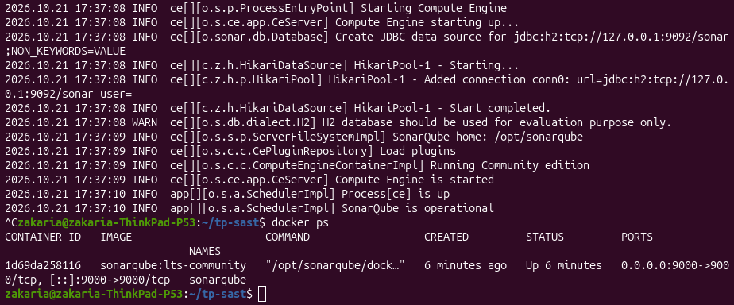
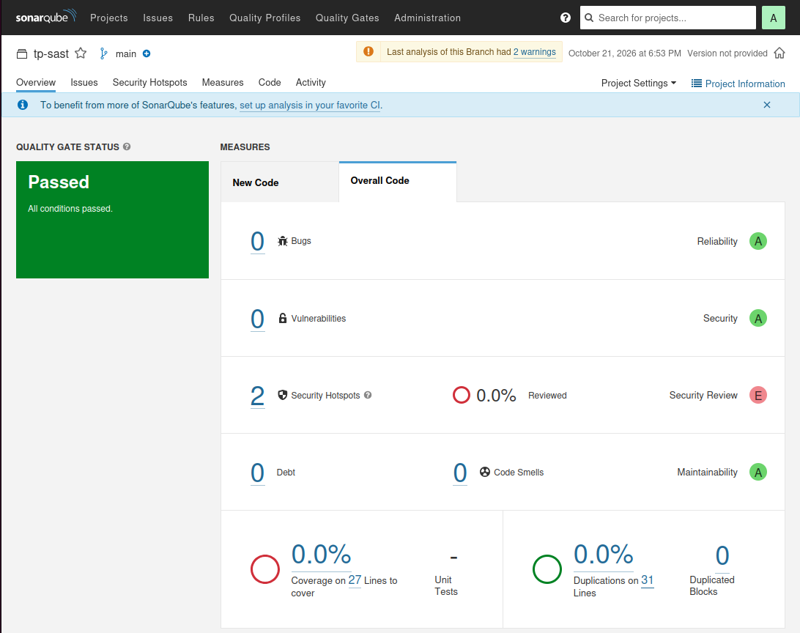
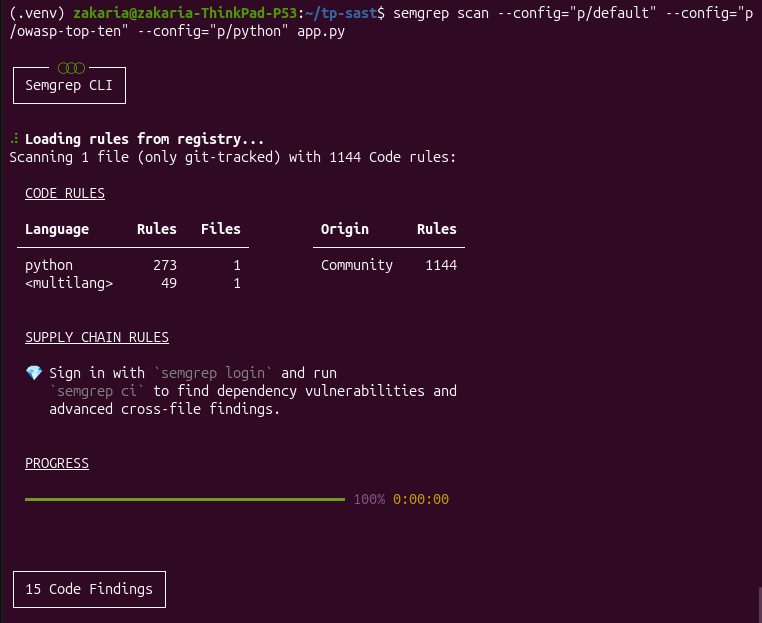
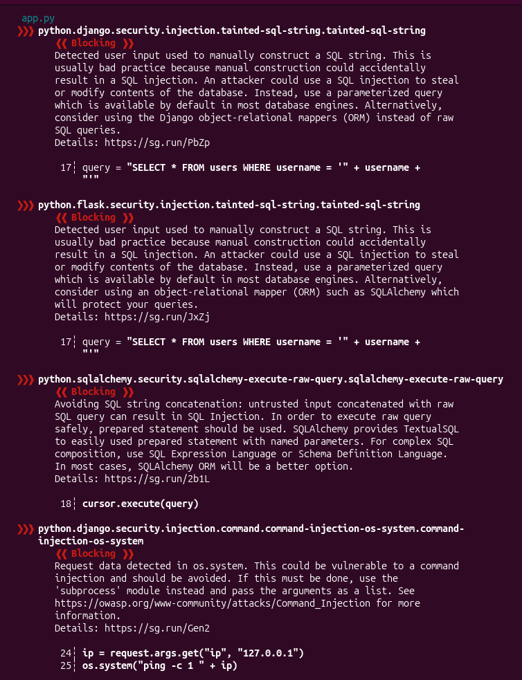
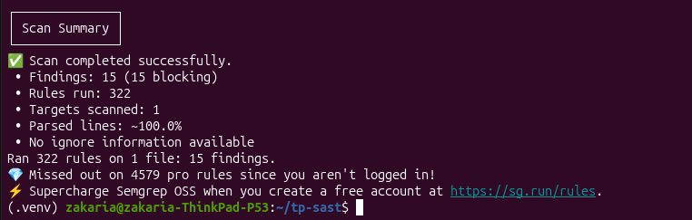
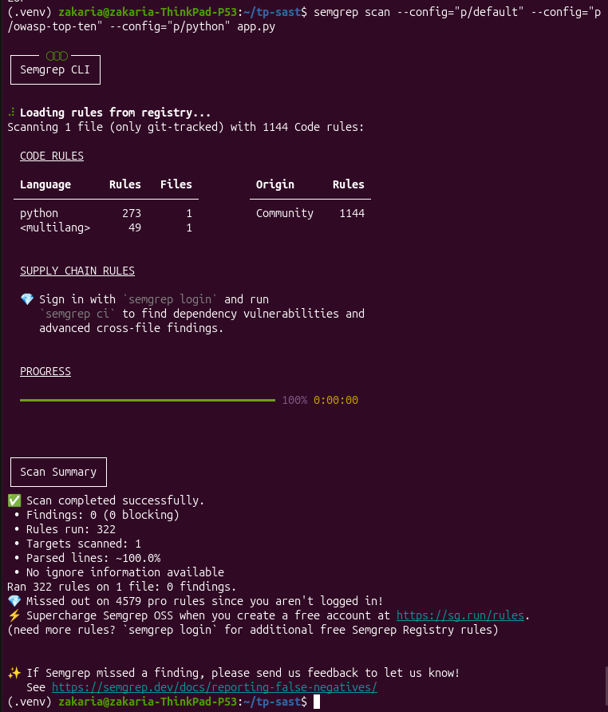
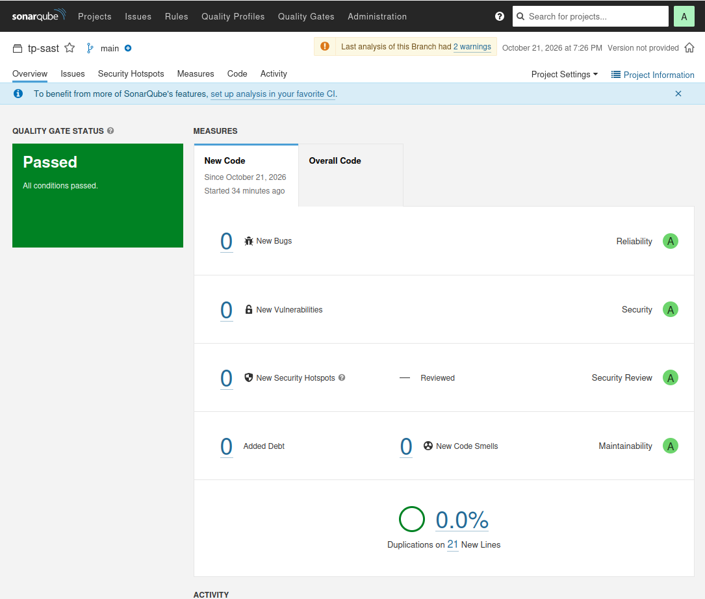
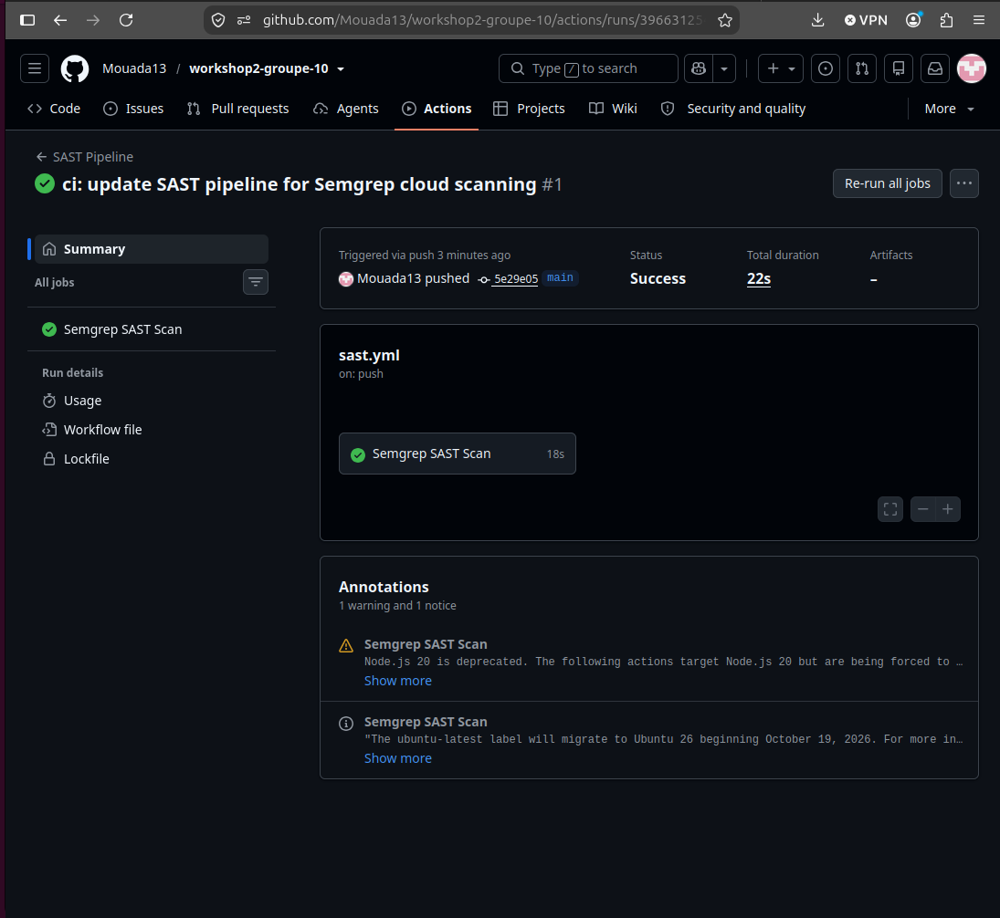

# Workshop 2 – Analyse SAST avec SonarQube et Semgrep

**Groupe :** 10  
**Membres :** Zakaria Aribi, Zakaria Mouada, Jihane Diouri

---

## 1. Objectif
Identifier, analyser et corriger les vulnérabilités de sécurité présentes dans le code source d'une application web Python (Flask) en combinant deux outils SAST complémentaires : **SonarQube** (déployé via Docker) et **Semgrep**. L'ensemble de la démarche est ensuite automatisé dans un pipeline d'intégration continue (CI) via GitHub Actions selon l'approche *Shift-Left Security*.

---

## 2. Déploiement de l'environnement (SonarQube via Docker)
Le serveur SonarQube (Community Edition LTS) a été instancié dans un conteneur Docker local avec persistance et mappage des ports sur `9000:9000`.

Avant le démarrage, la mémoire virtuelle du noyau Linux a été ajustée pour supporter le moteur Elasticsearch embarqué (`sudo sysctl -w vm.max_map_count=524288`).

```bash
docker run -d --name sonarqube -p 9000:9000 sonarqube:lts-community
```

Le conteneur démarre et passe à l'état opérationnel :



---

## 3. Analyse initiale et détection des vulnérabilités
L'application cible initiale (`app.py`) contient plusieurs failles critiques :
- Mot de passe administrateur codé en dur (`DB_PASSWORD`) ;
- Injection SQL (CWE-89) via concaténation directe d'entrées non assainies ;
- Injection de commandes système (CWE-78) via `os.system` ;
- Cross-Site Scripting (XSS / CWE-79) via `make_response` ;
- Exécution de code arbitraire (`eval`) et hachage cryptographique obsolète (`MD5`).

### 3.1. Analyse SonarQube
Le scan initial exécuté via `sonar-scanner-cli` a révélé un score de sécurité critique (**Security Rating E**) et identifié les éléments sensibles sous forme de *Security Hotspots* (mot de passe en dur, MD5 et gestion du CSRF) :



### 3.2. Analyse Semgrep
L'analyse par motif syntaxique (AST) avec les règles officielles Semgrep (`p/default`, `p/owasp-top-ten`, `p/python`) a détecté immédiatement **4 findings bloquants** liés au risque d'injection XSS et au bypass des mécanismes d'échappement HTML :

```bash
semgrep scan --config="p/default" --config="p/owasp-top-ten" --config="p/python" app.py
```





---

## 4. Comparaison technique : SonarQube vs Semgrep

| Critère | SonarQube | Semgrep |
| :--- | :--- | :--- |
| **Approche d'analyse** | Analyse sémantique globale, métriques de qualité, couverture et *Security Hotspots*. | Analyse syntaxique directe (AST) et détection ciblée par patterns. |
| **Rapidité & Déploiement** | Lourd (serveur, base de données, Docker, mémoire requise). | Très léger (exécution instantanée en CLI ou script pre-commit). |
| **Détection dans notre code** | Flagge la cryptographie faible, les configurations à risque et les secrets. | Détecte immédiatement les appels dangereux (`eval`, `os.system`, templates XSS). |
| **Limites observées** | L'édition Community nécessite une configuration fine pour l'analyse de flux Python. | La version open-source se concentre sur l'analyse intra-fichier (règles mono-fichier). |
| **Cas d'usage DevSecOps** | **Quality Gate centralisé** pour bloquer la fusion de branches en production. | **Feedback développeur immédiat** en local et validation rapide des Pull Requests. |

---

## 5. Remédiation et correction du code source
Le code source a été corrigé pour appliquer les recommandations OWASP :
1. **Suppression des secrets en clair :** Récupération via variable d'environnement (`os.getenv("DB_PASSWORD")`).
2. **Protection contre l'injection SQL :** Utilisation de requêtes paramétrées avec marqueurs de substitution (`?`).
3. **Protection contre l'injection OS :** Remplacement de `os.system` par `subprocess.run` sans interpréteur shell (`shell=False`).
4. **Protection XSS :** Remplacement des retours HTML bruts par des réponses d'API strictes et sécurisées au format JSON (`jsonify`).
5. **Désactivation d'`eval()` et de MD5 :** Remplacement par `ast.literal_eval()` et passage à l'algorithme `SHA-256`.

Après correction, le re-scan Semgrep ne remonte plus aucune alerte : **0 findings**.



Sur SonarQube, l'exclusion de la couverture de tests (`-Dsonar.coverage.exclusions="**/*"`) et la validation de la revue CSRF pour cette API JSON mènent à un **Quality Gate validé avec succès (PASSED)** et une note maximale (**Grade A**) sur tous les axes :



---

## 6. Pipeline CI/CD (GitHub Actions)
L'analyse a été intégrée dans le dépôt via le workflow `.github/workflows/sast.yml`. Il exécute les scanners en parallèle lors de chaque événement `push` ou `pull_request` :

```yaml
name: SAST Pipeline

on:
  push:
    branches: [ "main", "master" ]
  pull_request:
    branches: [ "main", "master" ]

jobs:
  semgrep:
    name: Semgrep Scan
    runs-on: ubuntu-latest
    steps:
      - name: Checkout repository
        uses: actions/checkout@v4

      - name: Run Semgrep SAST
        uses: semgrep/semgrep-action@v1
        with:
          config: >-
            p/default
            p/owasp-top-ten

  sonarqube:
    name: SonarQube Scan
    runs-on: ubuntu-latest
    steps:
      - name: Checkout repository
        uses: actions/checkout@v4
        with:
          fetch-depth: 0

      - name: Run SonarQube SAST
        uses: SonarSource/sonarqube-scan-action@v3
        env:
          SONAR_TOKEN: ${{ secrets.SONAR_TOKEN }}
          SONAR_HOST_URL: ${{ secrets.SONAR_HOST_URL }}
        with:
          args: >
            -Dsonar.projectKey=tp-sast
            -Dsonar.sources=.
```

---

## 7. Résultat dans le pipeline
Le workflow s'exécute avec succès sur GitHub Actions :



---

## 8. Conclusion
La complémentarité entre **Semgrep** et **SonarQube** illustre l'efficacité d'une chaîne DevSecOps robuste : Semgrep offre un retour immédiat aux développeurs lors de la saisie du code pour bloquer les failles courantes à la source (*Shift-Left*), tandis que SonarQube garantit une gouvernance globale de la dette technique, de la maintenabilité et des barrières d'acceptation de risque via les *Quality Gates*.